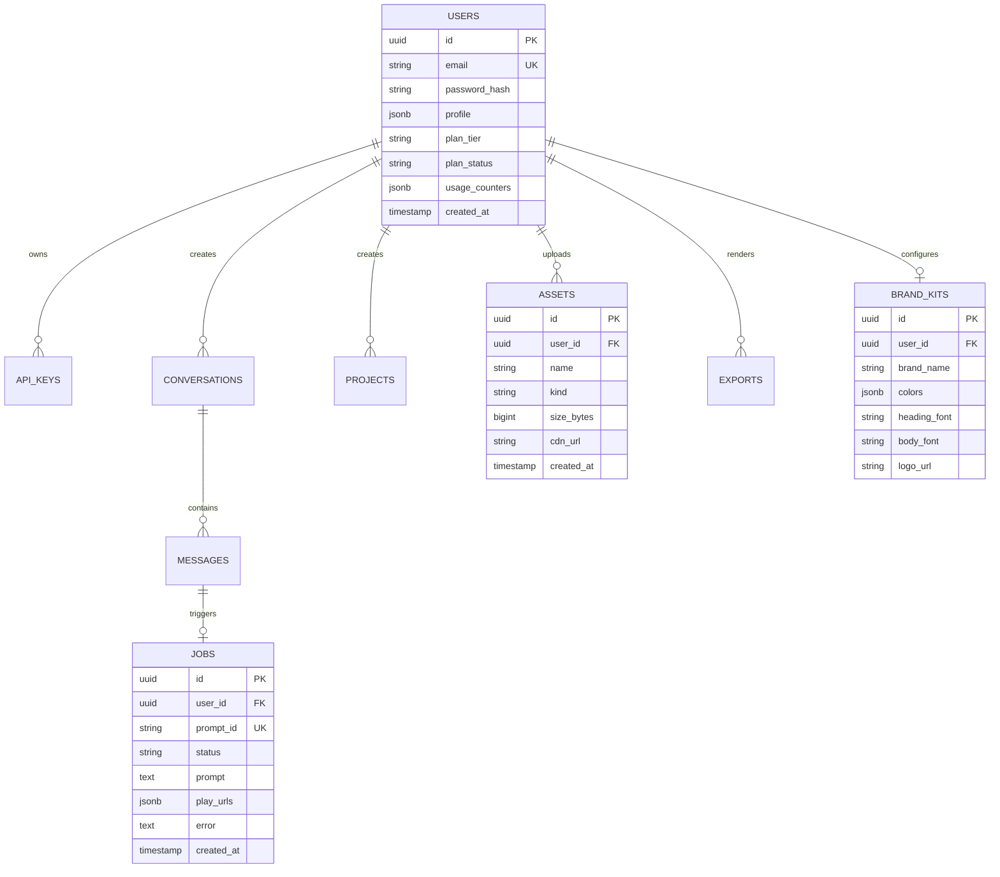

# Backend API Implementation TODO & Progress Tracker

> Structured checklist for the backend engineering team to track progress on implementing all REST endpoints, BullMQ workers, and Cloud integrations required by the Byreel Studio frontend (`e:\motion\frontend`).

---

## 📊 Implementation Progress Overview

- **Total Endpoints**: 40
- [ ] **Phase 1: Authentication & Session Management (P0)** — 8 tasks
- [ ] **Phase 2: Video Generation Engine & Job Queue (P0)** — 3 tasks
- [ ] **Phase 3: Subscriptions, Billing & Developer Keys (P0)** — 5 tasks
- [ ] **Phase 4: Cloud Media Storage & Asset Management (P0/P1)** — 3 tasks
- [ ] **Phase 5: User Settings, Conversations & History (P1)** — 11 tasks
- [ ] **Phase 6: Studio Creative Systems & URL Scraper (P1)** — 5 tasks
- [ ] **Phase 7: Catalogs, Motion Glyphs & Webhooks (P2)** — 5 tasks

---

## Phase 1: Authentication & Session Management (P0 — Critical)
> Required for users to log in, register, preserve sessions, and access workspace features.

- [ ] **`POST /api/login`**
  - **Controller**: `AuthController.login`
  - **Schema**: `{ email: string, password: string }`
  - **Requirements**:
    - [ ] Validate email format and check non-empty password.
    - [ ] Compare hashed password using bcrypt/argon2.
    - [ ] Generate JWT signed token with user ID and role.
    - [ ] Set HttpOnly cookies `token` and `animagent_token` (`SameSite=Lax`, `Max-Age=7d`).
    - [ ] Return `{ success: true, token, user }`.

- [ ] **`POST /api/register`**
  - **Controller**: `AuthController.register`
  - **Schema**: `{ name: string, email: string, password: string, plan?: string }`
  - **Requirements**:
    - [ ] Enforce minimum 8 characters for password.
    - [ ] Check email uniqueness in database.
    - [ ] Initialize default user profile, usage limits, and selected plan tier (`free`, `creator`, etc.).
    - [ ] Hash password and insert user record.
    - [ ] Issue JWT token and set cookies.

- [ ] **`GET /api/google/auth`**
  - **Controller**: `AuthController.googleAuth`
  - **Query Params**: `?origin=&mode=&plan=&popup=true`
  - **Requirements**:
    - [ ] Redirect client to Google OAuth 2.0 consent screen with state parameter preserving `origin`, `mode`, and `plan`.

- [ ] **`GET /api/google/url`**
  - **Controller**: `AuthController.getGoogleAuthUrl`
  - **Requirements**:
    - [ ] Return `{ success: true, url: string }` containing prepared OAuth redirect URL.

- [ ] **`GET /api/google/callback` (OAuth Callback Handler)**
  - **Requirements**:
    - [ ] Exchange authorization code with Google for tokens.
    - [ ] Upsert user record by `googleId` or matching email.
    - [ ] If `popup=true`, render HTML that sends `window.postMessage({ type: "GOOGLE_AUTH_SUCCESS", token, user }, origin)` and closes popup.
    - [ ] If standard redirect, set session cookies and redirect to `${origin}/dashboard`.

- [ ] **`POST /api/google`** (Direct Google Credential Token Exchange)
  - **Controller**: `AuthController.googleLogin`
  - **Schema**: `{ credential: string }` (Google ID token)
  - **Requirements**:
    - [ ] Verify Google ID token via Google Auth Client Library.
    - [ ] Find or create user and return session token.

- [ ] **`POST /api/google/register`**
  - **Controller**: `AuthController.googleRegister`
  - **Requirements**:
    - [ ] Same verification as above; sets custom initial plan if provided.

- [ ] **`POST /api/logout`**
  - **Controller**: `AuthController.logout`
  - **Requirements**:
    - [ ] Invalidate JWT token/session in database or Redis blocklist.
    - [ ] Clear cookies `token` and `animagent_token` (`Max-Age=0`).
    - [ ] Return `{ success: true, message: "Logged out successfully" }`.

---

## Phase 2: AI Video Generation & Job Queue Pipeline (P0 — Critical)
> The core generative motion engine. Connects frontend prompts to background GPU rendering workers.

- [ ] **`POST /api/prompt`**
  - **Controller**: `PromptController.queuePrompt`
  - **Schema**: `{ prompt: string, promptId: string, template?: string, userId?: string, ratio?: string, model?: string }`
  - **Requirements**:
    - [ ] Check authenticated user quota (`usage.generations.monthly < plan.limit`).
    - [ ] Increment generation counter.
    - [ ] Enforce idempotency: if `promptId` already exists, return existing job state.
    - [ ] Push job payload to BullMQ queue `AGENTQUEUE`.
    - [ ] Create Job record with status `queued` in database.
    - [ ] Return `{ success: true, job: { id, promptId, status: "queued" }, billing: { ... } }`.

- [ ] **`GET /api/prompt/:promptId`**
  - **Controller**: `PromptController.getPromptStatus`
  - **Requirements**:
    - [ ] Fetch job record by `promptId`.
    - [ ] If done, include cloud CDN player URLs in `play: string[]`.
    - [ ] If failed, return `status: "failed"` and `error: string`.
    - [ ] Return `{ success: true, job: PromptJob }`.

- [ ] **`POST /api/exports`**
  - **Controller**: `ExportController.createExport`
  - **Schema**: `{ projectId: string, resolution: "1080p" | "4K", format: "MP4" | "ProRes" | "WebM", fps: number }`
  - **Requirements**:
    - [ ] Check user render quota (`usage.renders.monthly < plan.limit`).
    - [ ] Verify resolution permissions (e.g. 4K only on Pro/Enterprise).
    - [ ] Submit high-bitrate render job to GPU cluster.
    - [ ] Return export job ID and estimated duration.

---

## Phase 3: Subscriptions, Billing & Developer Keys (P0 — Critical)
> Monetization, user tier upgrades, and developer API key access.

- [ ] **`POST /api/user/plan`**
  - **Controller**: `BillingController.updatePlan`
  - **Schema**: `{ tier: "free" | "creator" | "pro" | "enterprise", interval: "monthly" | "annual" }`
  - **Requirements**:
    - [ ] Update user's plan record in database.
    - [ ] Update limits (`generations.limit`, `renders.limit`, `storage.limitBytes`).
    - [ ] Return `{ success: true, message: string, user: BackendUser }`.

- [ ] **`POST /api/billing/create-checkout-session`** (Stripe Integration)
  - **Requirements**:
    - [ ] Create Stripe customer if absent.
    - [ ] Generate Stripe Checkout URL with success/cancel URLs.
    - [ ] Setup Stripe Webhook endpoint (`POST /api/billing/stripe-webhook`) to handle `invoice.payment_succeeded` and `customer.subscription.updated`.

- [ ] **`GET /api/keys`**
  - **Controller**: `ApiKeyController.listKeys`
  - **Requirements**:
    - [ ] Return all API keys for authenticated user (redacting raw secret, showing prefix only, e.g. `byreel_live_sk_89f0`).

- [ ] **`POST /api/keys`**
  - **Controller**: `ApiKeyController.createKey`
  - **Schema**: `{ name: string, environment?: string, scopes?: string[], expiresInDays?: number }`
  - **Requirements**:
    - [ ] Generate cryptographically secure random token prefixed with `byreel_live_sk_`.
    - [ ] Hash token with SHA-256 and store hash in database.
    - [ ] Return `{ success: true, apiKey: ApiKeyItem, secretKey: rawToken }` (rawToken returned **once only**).

- [ ] **`DELETE /api/keys/:keyId`**
  - **Controller**: `ApiKeyController.revokeKey`
  - **Requirements**:
    - [ ] Mark key status as `revoked` in database.

---

## Phase 4: Cloud Media Storage & Asset Management (P0/P1)
> Enables creators to upload logos, custom audio, video b-rolls, and custom fonts.

- [ ] **`POST /api/assets/upload`**
  - **Controller**: `AssetController.uploadAsset`
  - **Requirements**:
    - [ ] Support multipart/form-data or provide pre-signed S3/GCS PUT URL.
    - [ ] Validate MIME type (images, MP4/WebM videos, MP3/WAV audio, WOFF2/TTF fonts, GLTF/OBJ 3D models).
    - [ ] Check user storage limit (`usage.storage.usedBytes + file.size <= usage.storage.limitBytes`).
    - [ ] Save asset metadata and return CDN URL.

- [ ] **`GET /api/assets`**
  - **Controller**: `AssetController.listAssets`
  - **Requirements**:
    - [ ] Return list of user's uploaded assets with ID, name, kind, file size, CDN source URL, and timestamp.

- [ ] **`DELETE /api/assets/:id`**
  - **Controller**: `AssetController.deleteAsset`
  - **Requirements**:
    - [ ] Delete object from cloud bucket and decrement user's used storage counter.

---

## Phase 5: User Settings, Conversations & Project History (P1 — High)
> Profile management and multi-device persistence for chat sessions and projects.

- [ ] **`GET /api/user/me`**
  - **Controller**: `UserController.getMe`
  - **Requirements**:
    - [ ] Fetch complete user record, profile metadata, plan details, and live usage counters.

- [ ] **`PATCH /api/user/profile`**
  - **Controller**: `UserController.updateProfile`
  - **Schema**: `{ displayName?: string, firstName?: string, lastName?: string, company?: string, bio?: string, avatarUrl?: string }`
  - **Requirements**:
    - [ ] Validate fields and update profile object in database.

- [ ] **`PATCH /api/user/preferences`**
  - **Controller**: `UserController.updatePreferences`
  - **Schema**: `{ renderCompletionAlerts?: boolean, hardwareAcceleration?: boolean, productUpdates?: boolean }`
  - **Requirements**:
    - [ ] Save user preferences in database.

- [ ] **`GET /api/conversations`**
  - **Controller**: `ConversationController.list`
  - **Requirements**:
    - [ ] Return all chat short projects for authenticated user, newest first.

- [ ] **`POST /api/conversations`**
  - **Controller**: `ConversationController.create`
  - **Schema**: `{ title: string, prompt?: string }`
  - **Requirements**:
    - [ ] Create new conversation record with generated UUID and timestamp.

- [ ] **`PATCH /api/conversations/:id`**
  - **Controller**: `ConversationController.rename`
  - **Schema**: `{ title: string }`
  - **Requirements**:
    - [ ] Update conversation title.

- [ ] **`DELETE /api/conversations/:id`**
  - **Controller**: `ConversationController.delete`
  - **Requirements**:
    - [ ] Soft or hard delete conversation and associated messages.

- [ ] **`GET /api/projects`**
  - **Controller**: `ProjectController.list`
  - **Requirements**:
    - [ ] Return saved user projects with thumbnails, duration, status, and edit timestamps.

- [ ] **`DELETE /api/projects/:id`**
  - **Controller**: `ProjectController.delete`
  - **Requirements**:
    - [ ] Remove project record.

- [ ] **`GET /api/exports`**
  - **Controller**: `ExportController.listExports`
  - **Requirements**:
    - [ ] Return completed export history with download URLs, format, resolution, and file size.

- [ ] **`GET /api/billing/invoices`**
  - **Controller**: `BillingController.listInvoices`
  - **Requirements**:
    - [ ] Return array of past billing invoices with receipt PDF URLs.

---

## Phase 6: Studio Creative Systems & URL Scraper (P1 — High)
> Powers the Product Launch studio and Global Brand Kit.

- [ ] **`POST /api/launch/scan-url`**
  - **Controller**: `ProductLaunchController.scanUrl`
  - **Schema**: `{ url: string, category?: string }`
  - **Requirements**:
    - [ ] Fetch target landing page HTML with SSR / Cheerio / Puppeteer.
    - [ ] Extract OpenGraph title, description, brand logo, and dominant brand colors.
    - [ ] Run AI prompt summarizer to generate a 4-beat 30-second storyboard script.
    - [ ] Return `{ success: true, product: ExtractedProduct }`.

- [ ] **`POST /api/launch/generate`**
  - **Controller**: `ProductLaunchController.generateLaunchVideo`
  - **Schema**: `{ brandName: string, domain: string, tagline: string, keyFeature: string, brandColor: string, beats: string[], ratio: string }`
  - **Requirements**:
    - [ ] Synthesize Remotion / GPU composition using extracted storyboard beats.

- [ ] **`GET /api/brand-kit`**
  - **Controller**: `BrandKitController.getKit`
  - **Requirements**:
    - [ ] Fetch user's saved brand kit (palette, typography, tone, logo).

- [ ] **`PUT /api/brand-kit`**
  - **Controller**: `BrandKitController.saveKit`
  - **Schema**: `BrandKit` object (`brandName`, `tagline`, `colors`, `headingFont`, `bodyFont`, `voice`, `logoUrl`)
  - **Requirements**:
    - [ ] Upsert brand kit in database.

- [ ] **`POST /api/brand-kit/logo`**
  - **Controller**: `BrandKitController.uploadLogo`
  - **Requirements**:
    - [ ] Save logo image to cloud storage and update brand kit `logoUrl`.

---

## Phase 7: Catalogs, Motion Glyphs & Webhooks (P2 — Secondary)
> Template library, B-Roll catalog, vector glyph conversion, and webhook alerts.

- [ ] **`GET /api/templates`**
  - **Controller**: `TemplateController.list`
  - **Requirements**:
    - [ ] Return template catalog with category, ratio, difficulty, and starter prompts.

- [ ] **`GET /api/brolls`**
  - **Controller**: `BRollController.list`
  - **Requirements**:
    - [ ] Return curated library of loopable 4K B-Roll clips categorized by style and tags.

- [ ] **`POST /api/webhooks/test`**
  - **Controller**: `WebhookController.sendTestPayload`
  - **Requirements**:
    - [ ] Send test HTTP POST payload to user's registered webhook URL and verify response status.

- [ ] **`POST /api/motion/char-conversion`**
  - **Controller**: `MotionController.convertTextToGlyphs`
  - **Schema**: `{ text: string, fontFamily?: string, fontSize?: number, effect?: string, physics?: object }`
  - **Requirements**:
    - [ ] Generate procedural SVG paths and animation keyframes for font glyphs.

- [ ] **`GET /api/motion/glyphs`**
  - **Controller**: `MotionController.getGlyphs`
  - **Requirements**:
    - [ ] Return glyph bezier curves for input query string.

---

## 🛠 Recommended Database Schema Outline

